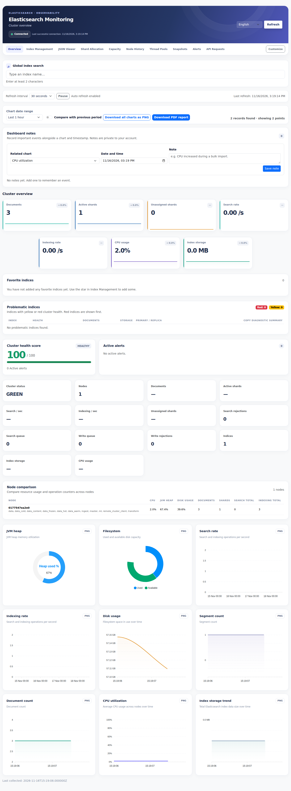
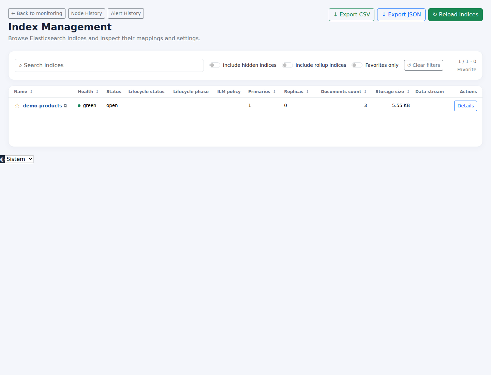
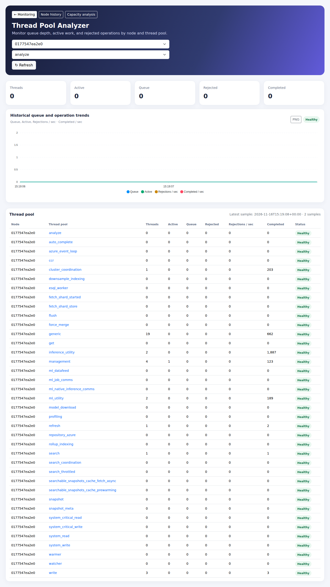

# Elasticsearch Monitoring

[](https://packagist.org/packages/elasticsearch-monitoring)
[](https://packagist.org/packages/elasticsearch-monitoring)
[](https://packagist.org/packages/elasticsearch-monitoring)
[](https://laravel.com)
[](https://github.com/mertaydin/elasticsearch-monitoring/actions/workflows/tests.yml)
[](LICENSE)


Elasticsearch kümelerini metrik toplama ve hafif bir yönetim paneliyle izlemek için Laravel paketi.

**Salt okunur tasarım:** Paket Elasticsearch metriklerini, indeks metadata bilgilerini, mapping, ayar ve yaşam döngüsü bilgilerini okur. İndeks oluşturmaz, değiştirmez, kapatmaz veya silmez; mapping, shard dağılımı ya da ILM politikalarını değiştirmez.

## Ekran görüntüleri

<!-- Ekran görüntüleri GitHub Actions tarafından güncel paket arayüzünden üretilir. -->

Görüntüler, GitHub Actions içinde geçici Laravel uygulamasında ve geçici Elasticsearch 8.18 kümesinde çalışan gerçek paket arayüzünden alınır. Elasticsearch yanıtları canlıdır; yalnızca demo indeks belgeleri örnek veridir.

| Küme paneli | İndeks yönetimi |
| --- | --- |
|  |  |



## Özellikler

- Tarayıcıda çalışan JSON Viewer: katlanabilir ağaç, anahtar/değer arama, kaynak düzenleme, biçimlendirme, küçültme, kopyalama ve indirme. Dosyalar tarayıcıdan dışarı gönderilmez.
- Node Performance: seçili düğümün IP, roller, CPU, JVM heap, disk, belge/shard ve primary/replica shard bilgileri.
- Düğümler arasında Elasticsearch sürüm karşılaştırması, sürüm dağılımı özeti ve sürüm farklılığı uyarısı. Veriler salt okunur `/_nodes` API'sinden alınır.
- Node Performance tablosunu CPU, JVM heap (RAM) veya disk kullanımına göre sıralama; en yüksek kullanım ilk sıradadır.
- Seçili tarih aralığı, küme adı, metrikler, görünür grafikler, önceki dönem karşılaştırması ve dönem notlarıyla PDF raporu. Tarayıcıda oluşturulur; ek Elasticsearch isteği veya sunucu PDF bağımlılığı gerektirmez.
- Grafikleri başlıklı PNG olarak ayrı ayrı veya görünür tüm grafikleri tek PNG olarak dışa aktarma.
- Geçmiş grafiklerini eşit uzunluktaki önceki dönemle karşılaştırma; önceki dönem çizgileri seçili aralığa hizalanır ve açılıp kapatılabilir.
- KPI, sağlık ve grafikler için kompakt gezinme, duyarlı kontroller ve tutarlı kartlarla yenilenmiş panel.
- 24 saati aşan aralıkları saatlik, 7 günü aşan aralıkları günlük ortalamalara dönüştürme; kısa aralıklarda ham gözlemleri koruma.
- Grafikleri son 1/6/24 saat, son 7 gün veya özel tarih aralığına göre filtreleme; seçimi yerel saklama ve yanıtları en fazla 2.000 örnek noktayla sınırlama.
- Otomatik yenileme aralıkları: 15 saniye, 30 saniye, 1 dakika veya 5 dakika. Duraklatma/sürdürme ve arka plan sekmesinde istekleri askıya alma.
- Shard Allocation Explorer: atanmış/atanmamış shard tahsis açıklamaları. Elasticsearch `monitor` küme yetkisi gerektirir ve küme durumunu değiştirmez.
- Sık kullanılan indeksleri tarayıcı favorilerine kaydetme, favorilere göre filtreleme ve panelden hızlı açma. Favori kartlarında sağlık, belge, depolama ve indeksleme işlem özetleri bulunur; migration gerekmez.
- Görünen indeks listesini arama/favori filtreleriyle birlikte UTF-8 CSV veya JSON dışa aktarma.
- İndeks/düğüm adlarını, IP adreslerini, shard indeks/düğüm kimliklerini ve snapshot repository/adlarını tek tıklamayla kopyalama.
- Index Management ayrıntılarından biçimlendirilmiş mapping JSON'un tamamını veya üst düzey bölümlerini kopyalama.
- Altı dilde yerelleştirilmiş pano geri bildirimi.
- İndeks adı, sağlık, primary/replica shard, belge sayısı ve depolama boyutu sütunlarında sıralama.
- Panelden canlı öneriler ve sağlık/belge/depolama özetleriyle genel indeks araması.
- Arama sorgusu, favori filtresi ve sıralama tercihlerini tarayıcı local storage alanında hatırlama; filtreleri tek tıklamayla sıfırlama.
- Düğüm bazında query/fetch hızları, ortalama gecikme, etkin işlemler, arama kuyrukları ve reddedilme oranlarının geçmiş takibi.
- Panel bölümlerini gizleme, sürükleyerek sıralama ve varsayılan düzeni geri yükleme.
- Yedi KPI kartını ayrı ayrı gösterme/gizleme, sıralama ve üste sabitleme.
- Seçili geçmiş grafiğine zaman damgalı özel operasyon notları ekleme; notlar veritabanında saklanır, ilgili grafikte gösterilir, düzenlenebilir ve silinebilir.

## Gereksinimler

- Laravel 12 için PHP 8.2+; Laravel 13 için PHP 8.3+
- Laravel 12 veya 13
- Elasticsearch 8.18+ veya 9.x

## Kurulum

```bash
composer require mertaydin/elasticsearch-monitoring
php artisan vendor:publish --tag=elasticsearch-monitoring-config
php artisan migrate
```

`.env` bağlantı ayarları:

```dotenv
ELASTICSEARCH_MONITORING_URL=http://127.0.0.1:9200
ELASTICSEARCH_MONITORING_USERNAME=
ELASTICSEARCH_MONITORING_PASSWORD=
ELASTICSEARCH_MONITORING_API_KEY=
ELASTICSEARCH_MONITORING_TIMEOUT=10
ELASTICSEARCH_MONITORING_VERIFY=true
```

Metrik anlık görüntüsü toplamak için `php artisan elasticsearch:collect` çalıştırın.

| Sayfa | Varsayılan adres |
| --- | --- |
| Panel | `/monitoring/elasticsearch` |
| İndeks yönetimi ve indeks performansı | `/monitoring/elasticsearch/indices` |
| Düğüm performans geçmişi | `/monitoring/elasticsearch/nodes` |
| Thread pool analizi | `/monitoring/elasticsearch/thread-pools` |
| Snapshot ve yedek izleme | `/monitoring/elasticsearch/snapshots` |
| Shard tahsisi | `/monitoring/elasticsearch/shards` |
| Kapasite analizi | `/monitoring/elasticsearch/capacity` |
| Uyarı geçmişi | `/monitoring/elasticsearch/alerts` |
| Bildirim teslim geçmişi | `/monitoring/elasticsearch/alerts/notifications` |
| Sorgu etkinliği | `/monitoring/elasticsearch/query-activity` |
| API istek geçmişi | `/monitoring/elasticsearch/api-requests` |

İndeks ayrıntı penceresindeki salt okunur performans analiz aracı indexing, search, merge, refresh, flush, query/request cache, segments ve translog istatistiklerini gösterir. Primary shard değerlerini primary+replica toplamlarıyla karşılaştırır ve yalnızca seçili indeksi yeniler. Elasticsearch `monitor` indeks yetkisi gerekir. Panel daima Laravel `web` ve `auth` middleware'lerini kullanır. Panel yolu ve dili `config/elasticsearch-monitoring.php` içinden ayarlanır. Bir dakikalık toplama görevi kaydetmek için `register_schedule=true` yapın ve Laravel scheduler'ı çalıştırın.

### Panel yetkilendirmesi

Uygulamanızın `AppServiceProvider::boot()` metodunda callback kaydedebilirsiniz:

```php
use ElasticsearchMonitoring\Facades\ElasticsearchMonitoring;

public function boot(): void
{
    ElasticsearchMonitoring::auth(function ($request) {
        return $request->user() && $request->user()->hasRole('SuperAdmin');
    });
}
```

Callback `true` döndürerek erişime izin verir; `false` HTTP 403 üretir. Callback tanımlanmazsa kimliği doğrulanmış kullanıcılar erişebilir. `web` ve `auth` middleware'leri daima etkindir.

## Sorgu etkinliği

Query Activity sayfası düğüm bazında query/fetch sayaçlarını ve işlemlerini, scroll/suggest hızlarını, işlem başına ortalama süreyi, search thread-pool kuyruk derinliğini ve reddedilme oranını gösterir. Hız ve ortalama süre sayaç farklarından hesaplandığı için en az iki başarılı toplama gerekir. Sayfa en son 1.440 saklanan anlık görüntüyü okur, görünümünü 30 saniyede bir yeniler ve ek Elasticsearch isteği göndermez. Güncelleme sonrası `php artisan elasticsearch:collect` çalıştırın; eski örnekler query activity verisi içermez.

## Elasticsearch API istek geçmişi

`/monitoring/elasticsearch/api-requests` panelin Elasticsearch'e gönderdiği GET isteklerini kaydeder: uç nokta, HTTP durumu, yanıt süresi, başarı/başarısızlık ve hata ayrıntıları. Son 500 istek listelenir; URL sorgu parametreleri ayıklanır, kimlik bilgileri ve istek gövdeleri kaydedilmez. `elasticsearch_api_request_logs` tablosu için güncelleme sonrası `php artisan migrate` çalıştırın.

## Favoriler, sıralama ve filtreler

Favoriler tarayıcının local storage alanında tutulur; tarayıcı/profil bazındadır, kullanıcılar veya cihazlar arasında eşitlenmez ve migration gerektirmez. **Name**, **Health**, **Primaries**, **Replicas**, **Documents count** ve **Storage size** sütunları sıralanabilir. İlk tıklama artan, ikinci tıklama azalan sıralar; sağlık Green, Yellow, Red şeklindedir. Arama, favori filtresi ve sıralama tercihleri yerel saklanır. URL'deki `search` parametresi kaydedilmiş arama metnine önceliklidir. **Clear filters** arama, favori, gizli/rollup filtrelerini temizler ve varsayılan sıralamayı geri yükler. Tarayıcı depolaması kullanılamazsa varsayılan görünüm kullanılır.

## Panel notları

**Dashboard notes** ile geçmiş grafiğine kesin tarih/saatte operasyonel olay ekleyin. Notlar kimliği doğrulanmış hesaba özel olarak paket veritabanında saklanır ve seçili tarih aralığına denk gelirse grafikte işaretçi olarak görünür. Notlar oluşturulabilir, düzenlenebilir ve silinebilir; en son 200 not gösterilir. `elasticsearch_dashboard_notes` tablosu için `php artisan migrate` çalıştırın. Notlar Elasticsearch'e yazılmaz.

## İndeks dışa aktarma

**Export CSV** veya **Export JSON**, geçerli arama ve favori filtrelerine uyan listeyi indirir. İndeks adı, sağlık, durum, belge sayısı, depolama baytları, primary/replica shard sayıları, varsa oluşturulma tarihi, data stream ve lifecycle metadata içerir. Dosyalar tarayıcıda üretilir; export endpoint, migration veya Elasticsearch yazma isteği yoktur.

## Metrikler ve uyarılar

Panel küme sağlık puanı, etkin uyarılar, düğüm CPU/JVM/disk kullanımı, belgeler, shard'lar, search/write thread-pool kuyrukları ve retleri ile sayaç farklarından hesaplanan arama/indeksleme hızlarını gösterir. Thread Pool Analyzer kuyruk, etkin, thread, tamamlanan ve reddedilen metrikleri ile geçmiş grafikler sunar. Snapshot Monitoring repository'leri, son snapshot'ları, shard sonuçlarını, hataları ve son başarılı yedeği listeler; `monitor_snapshot` küme yetkisi gerekir. Repository başına son 50 snapshot okunur, sonuçlar 60 saniye önbelleğe alınır; repository ayarları gösterilmez ve yedekleme işlemi yapılmaz.

Node Performance History en son 1.440 saklanan anlık görüntüden düğüm CPU, JVM heap, dosya sistemi, arama/indeksleme hızı ve thread-pool kuyruklarını grafikler. Shard Allocation sayfası CAT Shards salt okunur API'siyle primary/replica yerleşimini, shard durumlarını, atanmama nedenlerini ve düğüm dağılımını gösterir.

Uyarı eşikleri `alerts.thresholds` altında yapılandırılır. E-posta, Slack ve Microsoft Teams kanalları `alerts.notifications.channels` altında ayrı ayrı etkinleştirilebilir. Alıcıları/webhook URL'lerini ve cooldown süresini ayarlayın. Teslim denemeleri, hatalar ve cooldown nedeniyle bastırmalar `/monitoring/elasticsearch/alerts/notifications` sayfasında görünür. Asenkron teslimat için queue worker önerilir; senkron sürücü de çalışır. Hızlar iki başarılı toplamadan sonra kullanılabilir. Uyarı geçmişi olayın ilk görülmesini, sonraki gözlemleri, son değerini ve çözülme zamanını kaydeder. Mevcut kurulumlar güncelleme sonrası `php artisan migrate` çalıştırmalıdır.

## Kimlik ve mapping kopyalama

İndeks/düğüm adları, IP adresleri, shard kimlikleri ve snapshot repository/snapshot adları kopyalanabilir. Index Management ayrıntı penceresi mapping JSON'un tamamını veya üst düzey bölümlerini kopyalar. Pano geri bildirimi altı dilde yerelleştirilmiştir. Düğüm IP'leri node statistics yanıtından alınır ve sonraki anlık görüntülere yazılır; geçmiş anlık görüntüler geriye dönük doldurulmaz.

## Panel URL'si

Varsayılan adres `/monitoring/elasticsearch` şeklindedir. `config/elasticsearch-monitoring.php` içindeki `dashboard.path` değerini `panel/super/elasticsearch` gibi iç içe bir yola ayarlayabilirsiniz. Baştaki/sondaki slash karakterleri normalize edilir. Panel rotaları sabit `web` ve `auth` middleware'lerini kullanır:

```php
'dashboard' => [
    'path' => 'panel/super/elasticsearch',
],
```

## Uyumluluk

Sürüm `GET /` ile algılanır. Elasticsearch 8.18+ ve 9.x desteklenir. Laravel HTTP client kullanılır; resmi Elasticsearch PHP SDK gerekmez.

## Yerelleştirme

Türkçe (`tr`), İngilizce (`en`), Basitleştirilmiş Çince (`zh_CN`), Hintçe (`hi`), İspanyolca (`es`) ve Arapça (`ar`). Arapça RTL düzeni kullanır.

## Güvenlik

Paneli kimlik doğrulama ve yetkilendirme arkasında tutun. Kimlik bilgilerini ortam değişkenlerinde saklayın ve üretimde TLS doğrulamasını açık bırakın. Paket Elasticsearch'e karşı salt okunurdur; indeks, mapping, ayar, shard veya ILM değişikliği yapmaz. İndeks ayrıntıları ILM politikası, aşama, eylem, adım, indeks yaşı, rollover alias ve başarısız adım bilgisini salt okunur gösterir.

## Geliştirme

```bash
composer install
composer test
composer analyse
composer pint-test
```

## Bildirim ayarları

Bildirimler varsayılan olarak kapalıdır. Kullanacağınız kanalları yayımlanan yapılandırmada açın:

```php
'alerts' => [
    'notifications' => [
        'cooldown_minutes' => 30,
        'channels' => [
            'mail' => ['enabled' => true, 'recipients' => ['ops@example.com']],
            'slack' => ['enabled' => true, 'webhook_url' => env('ELASTICSEARCH_MONITORING_SLACK_WEBHOOK')],
            'teams' => ['enabled' => true, 'webhook_url' => env('ELASTICSEARCH_MONITORING_TEAMS_WEBHOOK')],
        ],
    ],
],
```

Slack/Teams webhook değişkenlerini ortamda tanımlayın. Yeni uyarı her kanala bir kez gönderilir; etkin olayın tekrar gözlemlenmesi yeniden gönderim yapmaz. Olay cooldown süresinde çözülüp tekrar oluşursa gönderim bastırılır ve kaydedilir. Kuyruk teslimatları başarısız olursa artan beklemeyle üç defaya kadar yeniden denenir. Asenkron queue bağlantısında worker çalıştırın.

## Panel düzeni ve otomatik yenileme

**Customize dashboard** ile özet, favoriler, sağlık, metrikler, düğüm karşılaştırması ve grafik bölümlerini gizleyip gösterin, sürükleyerek sıralayın veya varsayılan düzene dönün. Tercihler tarayıcı profiline özel local storage alanında tutulur.

Otomatik yenileme 15 saniye, 30 saniye, 1 dakika veya 5 dakika seçilebilir; duraklatılıp sürdürülebilir. Tercih tarayıcıda saklanır. Panel arka plandayken otomatik istekler askıya alınır ve tekrar görünür olduğunda devam eder. Son yenileme denemesi zamanı gösterilir; otomatik yenileme duraklatılsa da manuel yenileme kullanılabilir.

## Grafik dışa aktarma

Bir grafikte **Download PNG** ile başlıklı görüntü kaydedin veya **Download all charts as PNG** ile görünür grafikleri tek görselde birleştirin. Seçili tarih aralığı görsele eklenir. Dışa aktarma tarayıcıda yapılır; endpoint, veritabanı değişikliği veya ek Elasticsearch isteği gerekmez.

## Elasticsearch bağlantı durumu

Panel başlığı Elasticsearch root bilgi uç noktasını kontrol eder ve **Connected**, **Slow response** veya **Connection lost** durumunu; son başarılı bağlantı zamanı ve gecikmeyle birlikte gösterir. Durum metrik toplamadan bağımsız olarak 30 saniyede bir yenilenir. Yavaş yanıt eşiği varsayılan 1.000 ms'dir; `ELASTICSEARCH_MONITORING_SLOW_RESPONSE_MS` veya `connection.slow_response_ms` ile değiştirilebilir. Kontrol kimlik doğrulamalı, salt okunur GET isteğidir ve küme durumunu değiştirmez.

## Asset yayımlama

Paket güncellemesinden sonra panel tema asset'lerini yayımlayın:

```bash
php artisan vendor:publish --tag=elasticsearch-monitoring-assets --force
```

## Dokümantasyon ve lisans

- [Değişiklik günlüğü](CHANGELOG.md)
- [Katkıda bulunma](CONTRIBUTING.md)
- [Güvenlik](SECURITY.md)

MIT
